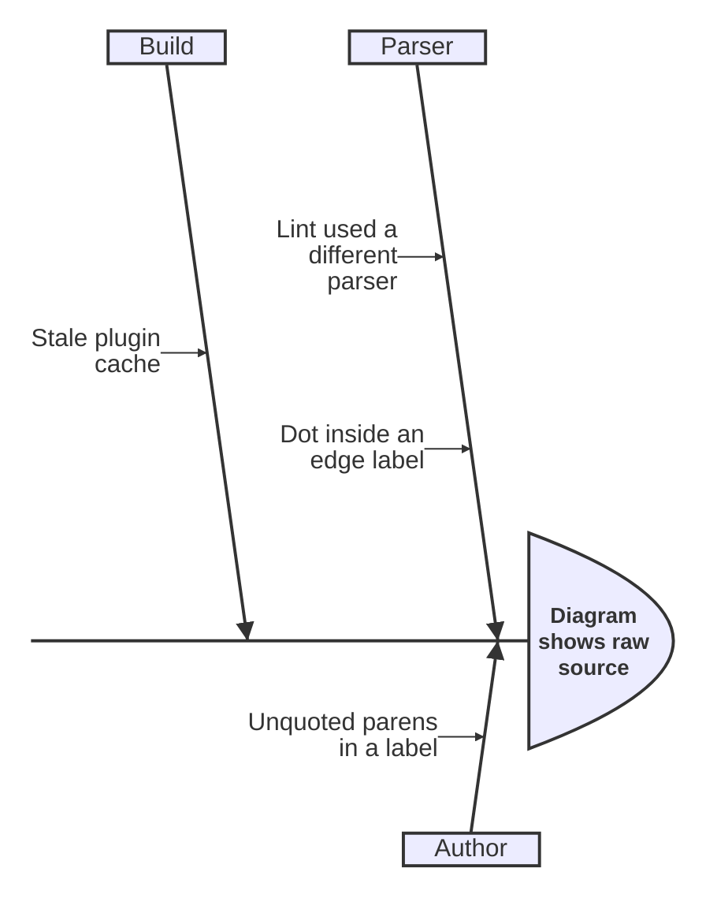
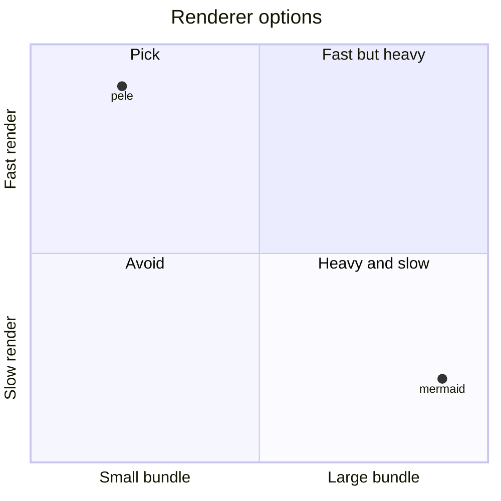
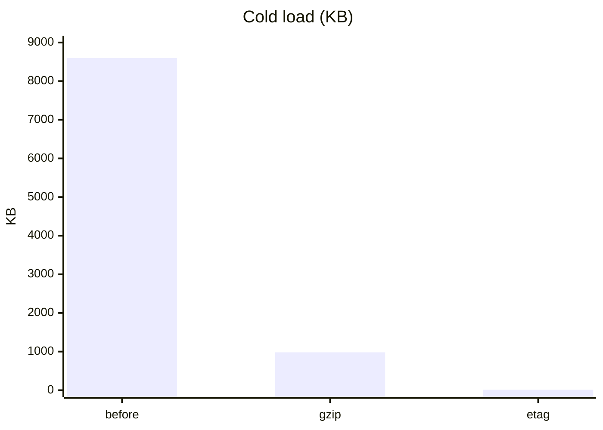
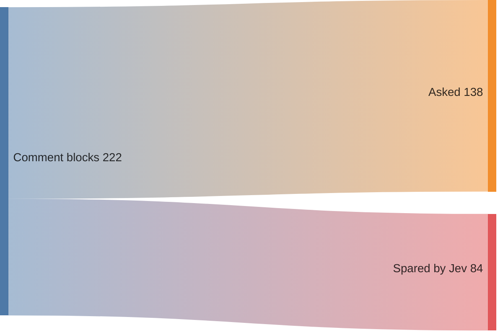

# Cockpit Mermaid diagrams

Use `--diagram` only when the insight is structural. A picture must carry it
better than prose: a flow, a state machine, a sequence, a dependency graph, a
fan-out, a before/after comparison, or a decision tree. Pass the Mermaid
source as one argument. Use a heredoc to preserve newlines.

The dashboard renders diagrams inline as Night Flight-themed SVG. Rendering is
sandboxed: the SVG profile is sanitized, and it allows no scripts or HTML
labels. If the source cannot parse in the dashboard, the card shows the
source as text instead of breaking.

The CLI lints the source before writing. Each of these exits non-zero with a
fix hint: an unknown diagram type, unbalanced brackets, an unknown `:::`
class, an unquoted `()` inside a `[...]` label, and a `[/…]` label that opens
a shape it never closes. Correct the source and re-run it, rather than
dropping the diagram.

**Quote any label with punctuation.** A bare `[...]` label is parsed for
shape syntax. Leading or embedded `/ \ ( )` characters break this parsing.
For example, `[/release]` reads as an unterminated parallelogram (`[/…/]`),
not as the literal text "/release", and this fails the whole parse. Whenever
the label carries a slash-command, a path, a parenthetical, or other
punctuation, wrap it in quotes, for example `["/release"]`. A plain-word
label such as `[read config]` needs no quotes.

## Pick the Mermaid type from the shape

The dashboard renders with [pele](https://pele.run/examples), which draws
every diagram type Mermaid 12.1 has plus a few of its own. Pick the type
whose shape matches the insight; a flowchart is the default only when
nothing below fits better.

| The insight is... | Use |
|---|---|
| states/statuses and what moves between them | `stateDiagram-v2` |
| a call chain / who-talks-to-whom over time | `sequenceDiagram` |
| a decision tree, branch, or fallback cascade | `flowchart TD` |
| a pipeline or dependency chain | `flowchart LR` |
| a before/after or two compared designs | `flowchart` with two `subgraph`s |
| a process handed between owners (user, hook, daemon) | `swimlane-beta LR` |
| why one failure happened, cause by cause | `ishikawa-beta` |
| options weighed on two axes (cost vs. payoff) | `quadrantChart` |
| a number measured across runs, sizes, or versions | `xychart` |
| shares of one whole (where the time or tokens went) | `pie` |
| a quantity flowing through stages and dropping out | `sankey` |
| sizes nested in a hierarchy (a bundle, a budget) | `treemap-beta` |
| a file or directory layout | `treeView-beta` |
| types, modules, and how they relate | `classDiagram` |
| tables, keys, and relations | `erDiagram` |
| services and the links between them | `architecture-beta` |
| branches, merges, and tags | `gitGraph` |
| what happened in order (an incident, a migration) | `timeline` |
| the space of options around one topic | `mindmap` |
| the bit or byte layout of a format | `packet` |
| the grammar of a command or format | `railroad-ebnf-beta` |

Any other type pele lists also passes the lint. The `-beta` types and
`swimlane-beta` are pele's own, so write them from the examples below rather
than from memory of Mermaid.

### Examples

A process that crosses owners:

```mermaid
swimlane-beta LR
  subgraph Agent
    edit[Edit file]
    fix[Fix comment]
  end
  subgraph Hook
    scan[Scan comment blocks]
    ask{3+ lines?}
  end
  edit --> scan --> ask
  ask -->|yes| fix
```

Root causes of one failure — the first line under the keyword is the effect,
each indented child a cause category:



Options on two axes, each point at `[x, y]` between 0 and 1:



A measurement across runs:



A quantity that drops out stage by stage, as `source,target,value` rows:



A file layout — indent children by four spaces and end a directory with `/`:


## Layout discipline

Draw the narrative, not the wiring. A decision-card diagram is a glance-sized
instrument, not a wiring schematic.

- **One main path.** The happy path reads in one direction, top-down or
  left-right. Side concerns hang off it as short stubs. They never cut
  across the main path.
- **Label only the non-obvious edges.** Use short event-like words, for
  example "retry", "timeout", or "cache miss". An arrow between adjacent
  steps needs no label.
- **Detail belongs in prose, not extra arrows.** If you add a node only to
  explain another node, move the explanation to `--reason`, `--facet`, or
  `--text` instead.
- **Edge budget: ~12.** Past that limit, delete edges until only the main
  narrative remains. Or split the insight into two entries.

## Night Flight node colours

Colour nodes by meaning with `:::class` markers. The renderer predefines the
palette. Do not write your own `classDef`.

Append the class to a node, e.g. `B[has env]:::ok`.

- `:::ok` — green, success/healthy path
- `:::bad` — red, failure/error path
- `:::fix` — amber, the fix or action to take
- `:::info` — cyan, a neutral note
- `:::warn` — dim amber, a softer caution
- `:::start` — grey, a neutral entry

Tag only the nodes that carry meaning; leave plumbing nodes untagged.
